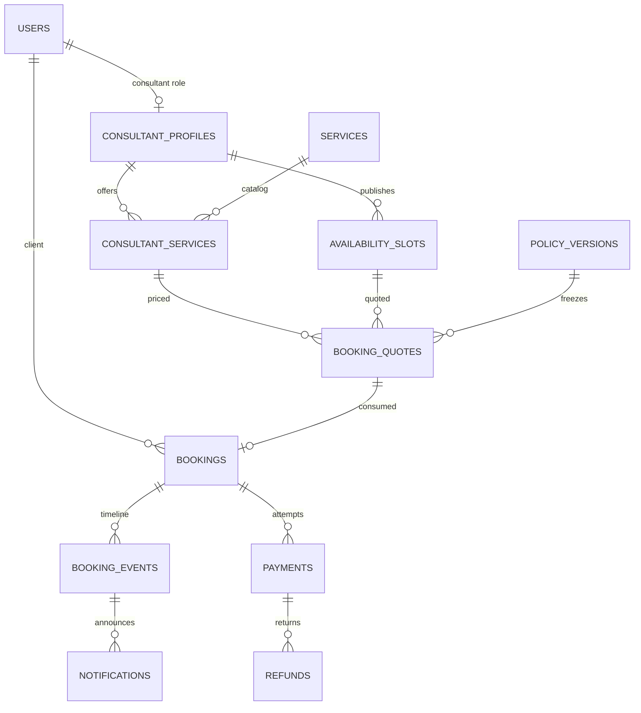

# Database implementation

Target: PostgreSQL 16+, schema `consultlink_v1`. Migration V1 is a fresh database foundation, not a lossless conversion of the old loosely related tables. It does not drop or modify the legacy `public` tables. Do not point the existing JPA entities at it: their IDs, column types and relationships are incompatible.

## Structure

| Table | Responsibility / important constraint |
|---|---|
| users | Login identity, role, BCrypt hash, account state, timezone, version; case-insensitive unique login/email |
| consultant_profiles | Approval/review details; composite FK ensures the user actually has CONSULTANT role |
| services | Admin catalog, duration, exact price/currency, active flag |
| consultant_services | Unique consultant/service offering, active flag |
| policy_versions | Immutable typed pricing/refund/deadline policy versions |
| platform_settings | Singleton current-policy pointer with optimistic version |
| availability_slots | Typed start/end and consultant FK; exclusion constraint rejects overlapping non-archived intervals |
| booking_quotes | Immutable service/time/price/policy snapshot; FKs require offering and slot to belong to the same consultant |
| bookings | One consumed quote; immutable ownership/context; partial unique index permits one reserving booking per slot |
| booking_events | Append-only booking timeline; actor or system origin |
| payments | Immutable sandbox attempt ledger; one successful payment per booking, amount/currency match quote |
| refunds | Cancellation-linked refund, bounded by successful payment, retry state/count; successful result immutable |
| notifications | Persisted recipient/read state, deduplicated by event/type |
| idempotency_records | Actor/operation/key uniqueness, request hash, response snapshot, minimum seven-day retention |
| audit_events | Append-only allowlisted administrative/action metadata |



## Invariant boundaries

SQL enforces foreign keys, role consistency for consultant profiles/client quotes, interval shape/overlap, immutable snapshots/history, reservation uniqueness, the legal status graph, successful-payment prerequisites, payment amount/currency, refund bounds, and payment/booking commit consistency. Quotes validate against the active catalog/current policy at creation. Catalog price changes do not reprice a quote. Existing valid quotes are rejected for new bookings if their offering/service/consultant is deactivated.

The deferred payment consistency triggers allow intermediate `PENDING_PAYMENT` inside the synchronous sandbox transaction but reject committing it. A successful payment must commit with a PAID/COMPLETED/CANCELLED booking. PAID/COMPLETED requires a successful payment. A later asynchronous payment implementation must deliberately redesign this recovery model.

The application still owns authenticated actor/role checks, approval review authority, exact policy deadlines, refund entitlement, optimistic version increments, notifications/events creation, and idempotent replay. Database checks do not replace Spring Security or application transactions. Failed refunds continue to reserve their amount in the refund ledger; retry the same row rather than creating a second financial claim.

All references default to restrictive deletion. Deactivate users/services/offerings; archive slots; preserve financial history. Quotes and policy versions cannot be updated or deleted by the runtime. Deleting old personal data requires a separately designed retention/anonymization process.

## Setup and cutover

1. Create a disposable PostgreSQL 16 database. The migration owner needs permission to create the schema and the `btree_gist` extension. In a managed database, ask its database administrator to provision the extension if necessary.
2. Apply once: `psql -X -v ON_ERROR_STOP=1 -d consultlink_test -f database/migrations/V1__consultlink_core.sql`. A second application fails because V1 is intentionally not an idempotent reset script. Never use a production database for the constraint tests.
3. Run `psql -X -v ON_ERROR_STOP=1 -d consultlink_test -f database/tests/constraints.sql`. Tests use `.invalid` fixture accounts, roll back their data, and force deferred checks before rollback. The schema itself remains installed in that disposable database.
4. Bootstrap an administrator using a separately supplied password and BCrypt hash, then create policy version 1 and singleton settings. Supply secrets through environment/secret management; do not copy a plaintext default admin into source. The test hash is deliberately a syntax-only fixture, not an application seed.
5. Implement v1 JPA mappings using UUID, `Instant`, BigDecimal and `@Version`. Configure an explicit Flyway schema migration location and set Hibernate `ddl-auto=validate`. Use a migration owner separate from the runtime database role. Grant runtime schema USAGE and required table SELECT/INSERT/UPDATE privileges, with no DDL, no DELETE on history, and no UPDATE on immutable tables. Avoid owner/superuser credentials in application configuration.
6. Wire transactional services and v1 controllers, disable legacy mutation endpoints, then migrate complete UI workflows. The existing application continues to use the legacy schema until this cutover is completed.

### Isolated local test runner

With Docker Desktop running and the official `postgres:16-alpine` image already cached:

```powershell
powershell -NoProfile -File scripts/test-database.ps1
```

The runner creates its own randomly named container, uses no host port/network or persistent volume, applies the migration/tests, and stops only that container in `finally`. It never pulls images or connects to the application's database.

### Contract checks

```text
node scripts/build-openapi.cjs
node scripts/check-openapi.cjs
```

The dependency-free checker verifies references, path parameters, unique operation IDs, explicit security/role scope, CSRF, important idempotency headers, DTO restrictions and consistent error responses. It is a structural checker, not certification by a full OpenAPI validator.

The focused GitHub Actions workflow runs these contract checks and the actual SQL tests against an isolated PostgreSQL 16 service. It does not claim the legacy Spring application implements the v1 API.

## Follow-up runtime tests

Add Testcontainers integration tests for concurrent slot reservation and refund/payment races when transactional Java services are implemented. SQL negative tests are useful but do not prove correct locking under two application transactions. Also verify session/CSRF/ownership through MockMvc, state/policy boundaries with a fixed Clock, and browser flows against the v1 adapters.

## PostgreSQL references

- [Constraints](https://www.postgresql.org/docs/16/ddl-constraints.html): FK/check/unique responsibilities and the limits of cross-row CHECK expressions.
- [Range types](https://www.postgresql.org/docs/16/rangetypes.html): `[)` intervals and exclusion constraints.
- [Partial indexes](https://www.postgresql.org/docs/16/indexes-partial.html): uniqueness limited to reserving/successful rows.
